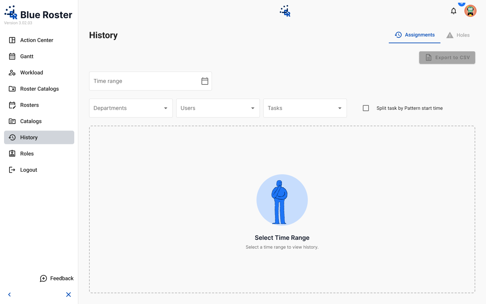
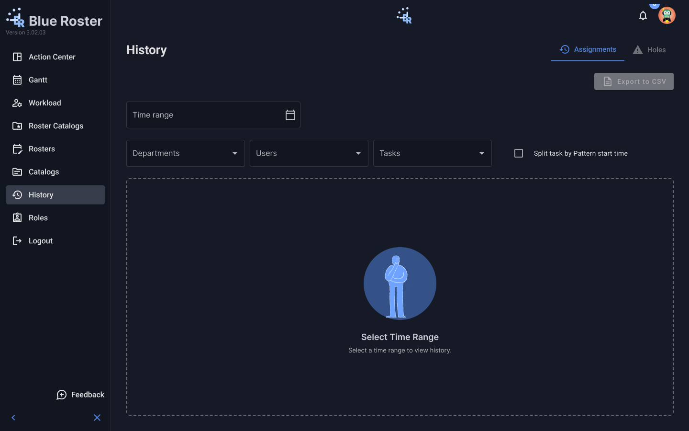

# History · Assignments (Admin)

- **Figma:** [Light](https://www.figma.com/design/k05NWBKMjsvo5hEugQc2Tq/Design-System-Legacy?node-id=306-18369) · [Dark](https://www.figma.com/design/k05NWBKMjsvo5hEugQc2Tq/Design-System-Legacy?node-id=306-18483)
- **Platform:** Admin web app, desktop 1440×900, `br-app-shell` App=Admin
- **Content component:** `br-content-history-assignments`

## Purpose
Assignment history.

## Components
br-app-shell, br-page-header, br-checkbox, br-table

## States
- Designed: Default (Light, Dark).
- Not designed yet: loading, error, skeleton (see README gaps). Empty state, where needed, uses `br-empty-state-panel`.

## Visual reference

Exported from Figma (mobile at 2x, desktop/admin at 1x). Match these pixel-for-pixel before anything else.

**Default**

 

## Anatomy (extracted from the Light frame)

Order is top to bottom as in the Figma layer tree. x,y are relative to the parent. Paddings are top/right/bottom/left in px. Tokens are the variables bound in Figma. Full trimmed tree: see `json/`.

### Default (`306:18369`)

| Layer | Component / type | x,y | Size | Layout · tokens |
|---|---|---|---|---|
| Sidebar | `br-app-sidebar / Collapsed=False` | 0,0 | 232×900 | vertical, gap 0, padding 16/12/16/12; bg br/contrast; border mat/sidenav-container-divider-color |
| ↳ Brand | `fram` | 12,16 | 202×59 | vertical, gap 4, padding 0/0/0/0 |
| ↳ Spacer | `fram` | 12,75 | 10×24 | horizontal, gap 0, padding 0/0/0/0 |
| ↳ Nav | `fram` | 12,99 | 208×424 | vertical, gap 8, padding 0/0/0/0 |
| ↳ Fill | `fram` | 12,523 | 207×281 | horizontal, gap 0, padding 0/0/0/0 |
| ↳ Feedback | `fram` | 12,804 | 207×40 | horizontal, gap 8, padding 8/0/8/0 |
| ↳ Controls | `fram` | 12,844 | 207×40 | horizontal, gap 0, padding 16/4/0/4 |
| Main | `fram` | 232,0 | 1208×900 | vertical, gap 0, padding 0/0/0/0 |
| ↳ Topbar | `br-app-topbar` | 0,0 | 1208×64 | horizontal, gap 0, padding 8/16/8/32 |
| ↳ Content | `fram` | 0,64 | 1208×836 | vertical, gap 24, padding 16/32/32/32 |

Node tree: [`json/history-assignments.json`](json/history-assignments.json)

