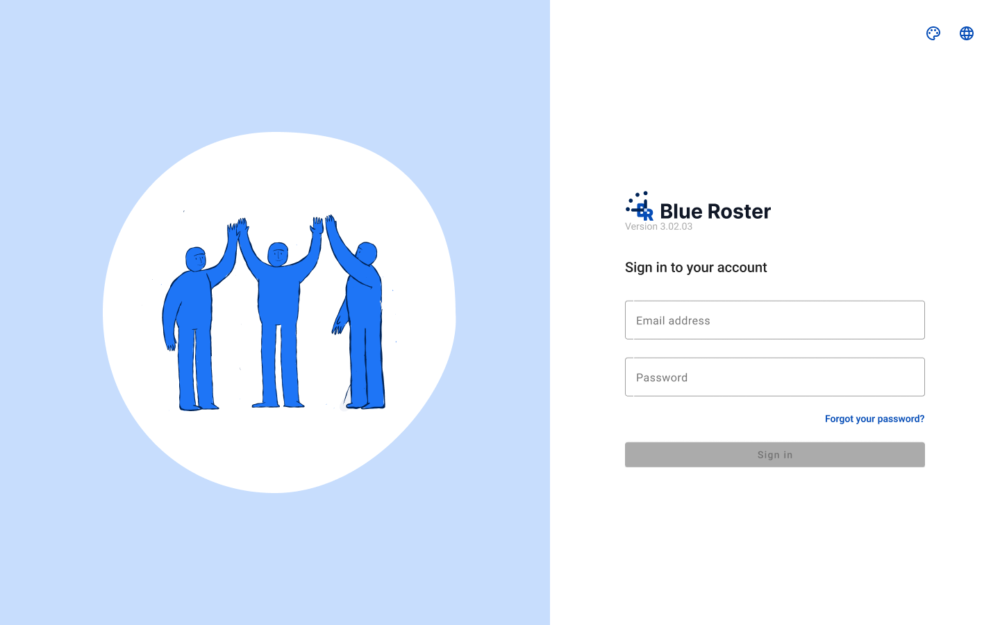
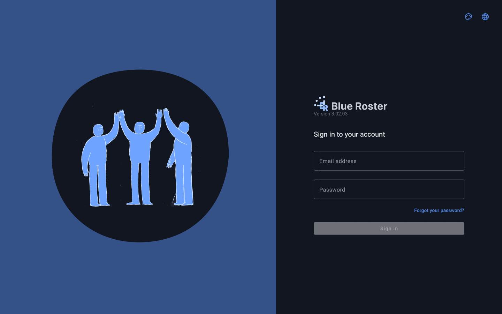

# Sign in (Admin)

- **Figma:** [Light](https://www.figma.com/design/k05NWBKMjsvo5hEugQc2Tq/Design-System-Legacy?node-id=234-21) · [Dark](https://www.figma.com/design/k05NWBKMjsvo5hEugQc2Tq/Design-System-Legacy?node-id=234-104)
- **Platform:** Admin web app, desktop 1440×900, `br-app-shell` App=Admin (not used: standalone sign-in layout)
- **Content component:** —

## Purpose
Authentication entry for Blue Roster (admin web).

## Components
br-logo, br-signin-illustration (Theme=Light/Dark), br-input, br-button

## States
- Designed: Default (Light, Dark).
- Not designed yet: loading, error, skeleton (see README gaps). Empty state, where needed, uses `br-empty-state-panel`.

## Visual reference

Exported from Figma (mobile at 2x, desktop/admin at 1x). Match these pixel-for-pixel before anything else.

**Default**

 

## Anatomy (extracted from the Light frame)

Order is top to bottom as in the Figma layer tree. x,y are relative to the parent. Paddings are top/right/bottom/left in px. Tokens are the variables bound in Figma. Full trimmed tree: see `json/`.

### Default (`234:21`)

| Layer | Component / type | x,y | Size | Layout · tokens |
|---|---|---|---|---|
| Illustration panel | `fram` | 0,0 | 792×900 | vertical, gap 0, padding 0/0/0/0; bg br/illustration-primary-lightest |
| ↳ Sign in illustration | `fram` | 116,170 | 560×560 |  |
| Form panel | `fram` | 792,0 | 648×900 | vertical, gap 0, padding 24/24/24/24 |
| ↳ Tools | `fram` | 24,24 | 600×48 | horizontal, gap 0, padding 0/0/0/0 |
| ↳ Center | `fram` | 24,72 | 600×804 | vertical, gap 0, padding 0/0/0/0 |

Node tree: [`json/sign-in.json`](json/sign-in.json)

