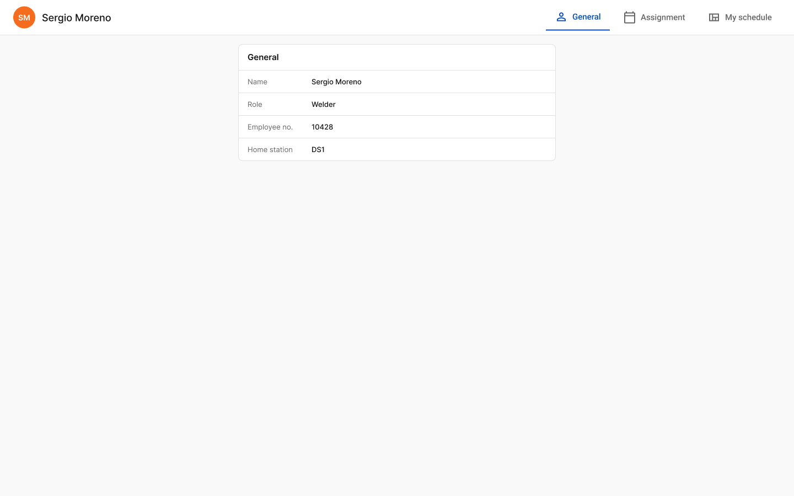
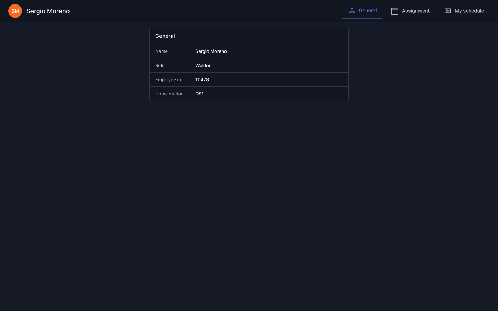
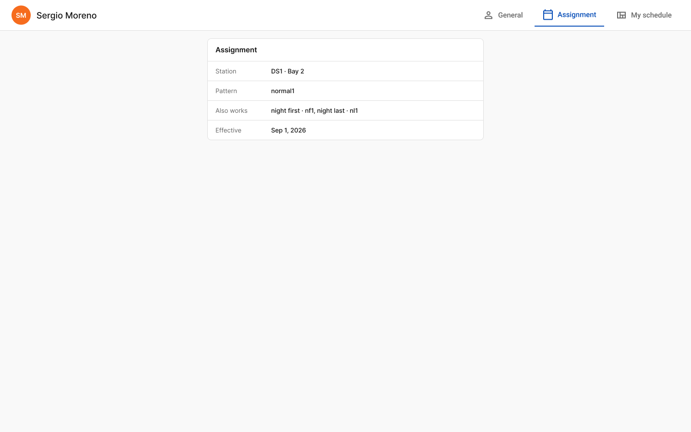
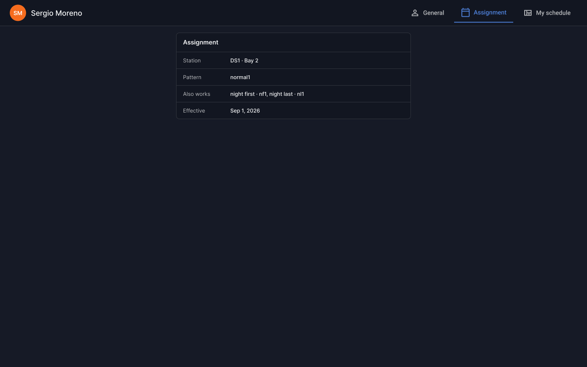

# Employee profile (desktop)

- **Platform:** Employee app · Desktop (1440)
- **Shell:** `br-app-shell` App=Employee (sidebar: My Schedule, Overtime, Time Off, Sick Time, Logout)

## Components
ms-employee-header, ms-definition-card, ms-definition-row

## Designed states / frames
- **Employee · General**: [Light](https://www.figma.com/design/k05NWBKMjsvo5hEugQc2Tq/Design-System-Legacy?node-id=336-24617) 1440×900 · [Dark](https://www.figma.com/design/k05NWBKMjsvo5hEugQc2Tq/Design-System-Legacy?node-id=336-24787) 1440×900
- **Employee · Assignment**: [Light](https://www.figma.com/design/k05NWBKMjsvo5hEugQc2Tq/Design-System-Legacy?node-id=336-24649) 1440×900 · [Dark](https://www.figma.com/design/k05NWBKMjsvo5hEugQc2Tq/Design-System-Legacy?node-id=336-24791) 1440×900

## Not designed yet
Loading, error, skeleton. Do not invent them silently; flag in the PR and follow README gaps.

## Visual reference

Exported from Figma (mobile at 2x, desktop/admin at 1x). Match these pixel-for-pixel before anything else.

**Employee · General**

 

**Employee · Assignment**

 

## Anatomy (extracted from the Light frame)

Order is top to bottom as in the Figma layer tree. x,y are relative to the parent. Paddings are top/right/bottom/left in px. Tokens are the variables bound in Figma. Full trimmed tree: see `json/`.

### Employee · General (`336:24617`)

| Layer | Component / type | x,y | Size | Layout · tokens |
|---|---|---|---|---|
| Employee header | `ms-employee-header / Active=General` | 0,0 | 1440×64 | horizontal, gap 0, padding 0/24/0/24; bg br/contrast; border br/component-border |
| ↳ Employee | `fram` | 24,12 | 178×40 | horizontal, gap 12, padding 0/0/0/0 |
| ↳ Employee nav | `fram` | 990,8 | 426×48 | horizontal, gap 8, padding 0/0/0/0 |
| Body | `fram` | 0,64 | 1440×276 | vertical, gap 12, padding 16/0/48/0 |
| ↳ General card | `ms-definition-card` | 432,16 | 576×212 | vertical, gap 0, padding 0/0/0/0; bg br/contrast; border br/component-border; radius 8 |

Node tree: [`json/employee-profile-desktop--employee-general.json`](json/employee-profile-desktop--employee-general.json)

### Employee · Assignment (`336:24649`)

| Layer | Component / type | x,y | Size | Layout · tokens |
|---|---|---|---|---|
| Employee header | `ms-employee-header / Active=Assignment` | 0,0 | 1440×64 | horizontal, gap 0, padding 0/24/0/24; bg br/contrast; border br/component-border |
| ↳ Employee | `fram` | 24,12 | 178×40 | horizontal, gap 12, padding 0/0/0/0 |
| ↳ Employee nav | `fram` | 990,8 | 426×48 | horizontal, gap 8, padding 0/0/0/0 |
| Body | `fram` | 0,64 | 1440×276 | vertical, gap 12, padding 16/0/48/0 |
| ↳ Assignment card | `ms-definition-card` | 432,16 | 576×212 | vertical, gap 0, padding 0/0/0/0; bg br/contrast; border br/component-border; radius 8 |

Node tree: [`json/employee-profile-desktop--employee-assignment.json`](json/employee-profile-desktop--employee-assignment.json)

