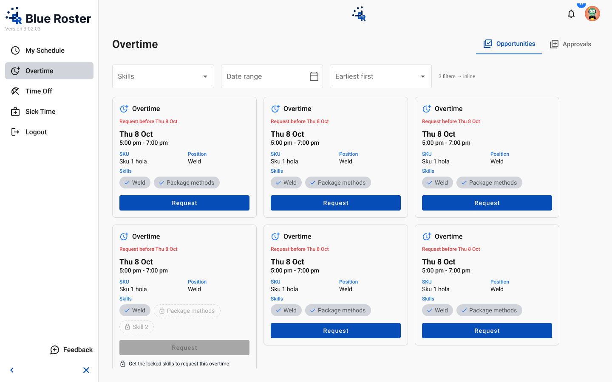
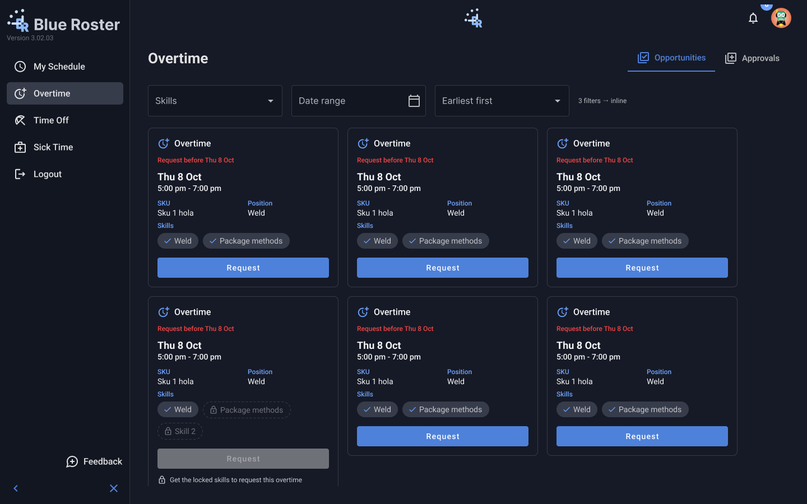
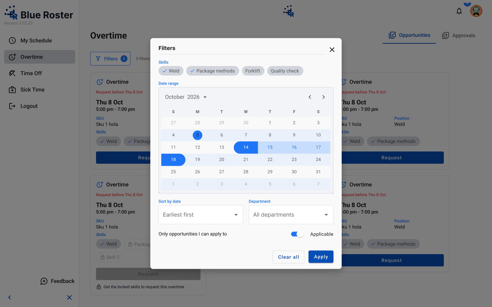
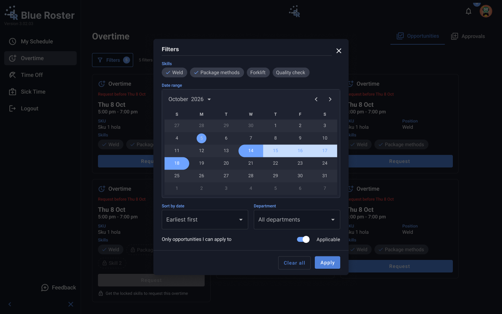

# Overtime · Opportunities (desktop filters)

- **Platform:** Employee app · Desktop (1440)
- **Shell:** `br-app-shell` App=Employee (sidebar: My Schedule, Overtime, Time Off, Sick Time, Logout)

## Components
br-app-shell (App=Employee), br-filter-button, br-filter-dialog (Device=Desktop), br-overtime-card; content: br-content-overtime-opportunities-inline (1–3 filters) / -filter-button (4+)

## Designed states / frames
- **Overtime · Desktop · 3 filters inline**: [Light](https://www.figma.com/design/k05NWBKMjsvo5hEugQc2Tq/Design-System-Legacy?node-id=394-8954) 1440×900 · [Dark](https://www.figma.com/design/k05NWBKMjsvo5hEugQc2Tq/Design-System-Legacy?node-id=394-9763) 1440×900
- **Overtime · Desktop · 4+ filters dialog**: [Light](https://www.figma.com/design/k05NWBKMjsvo5hEugQc2Tq/Design-System-Legacy?node-id=394-9222) 1440×900 · [Dark](https://www.figma.com/design/k05NWBKMjsvo5hEugQc2Tq/Design-System-Legacy?node-id=394-9784) 1440×900

## Not designed yet
Loading, error, skeleton. Do not invent them silently; flag in the PR and follow README gaps.

## Visual reference

Exported from Figma (mobile at 2x, desktop/admin at 1x). Match these pixel-for-pixel before anything else.

**Overtime · Desktop · 3 filters inline**

 

**Overtime · Desktop · 4+ filters dialog**

 

## Anatomy (extracted from the Light frame)

Order is top to bottom as in the Figma layer tree. x,y are relative to the parent. Paddings are top/right/bottom/left in px. Tokens are the variables bound in Figma. Full trimmed tree: see `json/`.

### Overtime · Desktop · 3 filters inline (`394:8954`)

| Layer | Component / type | x,y | Size | Layout · tokens |
|---|---|---|---|---|
| br-app-shell · Employee | `br-app-shell / App=Employee` | 0,0 | 1440×900 | horizontal, gap 0, padding 0/0/0/0; bg br/neutral-white |
| ↳ Sidebar | `br-app-sidebar / Collapsed=False` | 0,0 | 232×900 | vertical, gap 0, padding 16/12/16/12; bg br/contrast; border mat/sidenav-container-divider-color |
| ↳ Main | `fram` | 232,0 | 1208×900 | vertical, gap 0, padding 0/0/0/0 |

Node tree: [`json/overtime-opportunities-desktop-filters--overtime-desktop-3-filters-inline.json`](json/overtime-opportunities-desktop-filters--overtime-desktop-3-filters-inline.json)

### Overtime · Desktop · 4+ filters dialog (`394:9222`)

| Layer | Component / type | x,y | Size | Layout · tokens |
|---|---|---|---|---|
| br-app-shell · Employee | `br-app-shell / App=Employee` | 0,0 | 1440×900 | horizontal, gap 0, padding 0/0/0/0; bg br/neutral-white |
| ↳ Sidebar | `br-app-sidebar / Collapsed=False` | 0,0 | 232×900 | vertical, gap 0, padding 16/12/16/12; bg br/contrast; border mat/sidenav-container-divider-color |
| ↳ Main | `fram` | 232,0 | 1208×900 | vertical, gap 0, padding 0/0/0/0 |
| br-overlay-backdrop | `br-overlay-backdrop` | 0,0 | 1440×900 | horizontal, gap 0, padding 0/0/0/0; bg br/overlay-2 |
| br-filter-dialog | `br-filter-dialog / Device=Desktop` | 440,112 | 560×677 | vertical, gap 0, padding 0/0/0/0; bg br/neutral-white; radius 8 |
| ↳ Header | `fram` | 0,0 | 560×48 | horizontal, gap 8, padding 20/16/0/24 |
| ↳ Body | `fram` | 0,48 | 560×558 | vertical, gap 16, padding 16/24/20/24 |
| ↳ Footer | `fram` | 0,606 | 560×71 | horizontal, gap 12, padding 16/24/16/24; bg br/neutral-white; border br/divider |

Node tree: [`json/overtime-opportunities-desktop-filters--overtime-desktop-4-filters-dialog.json`](json/overtime-opportunities-desktop-filters--overtime-desktop-4-filters-dialog.json)

