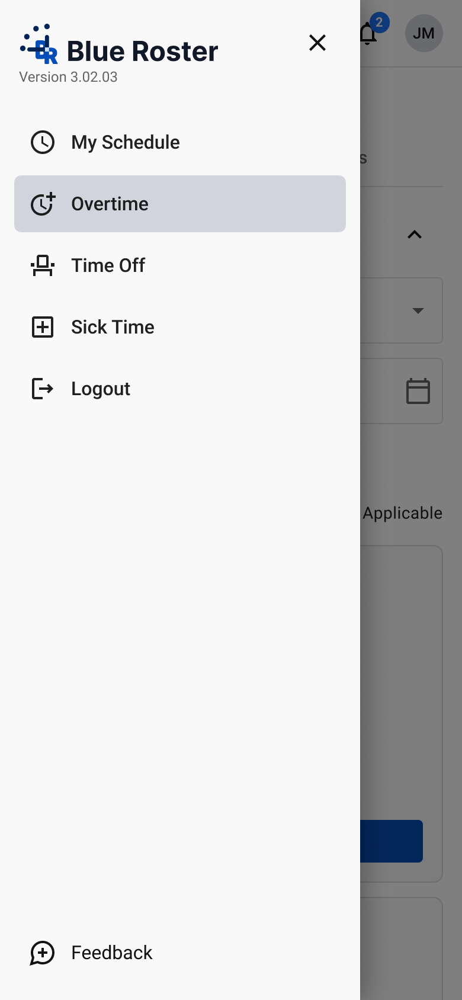
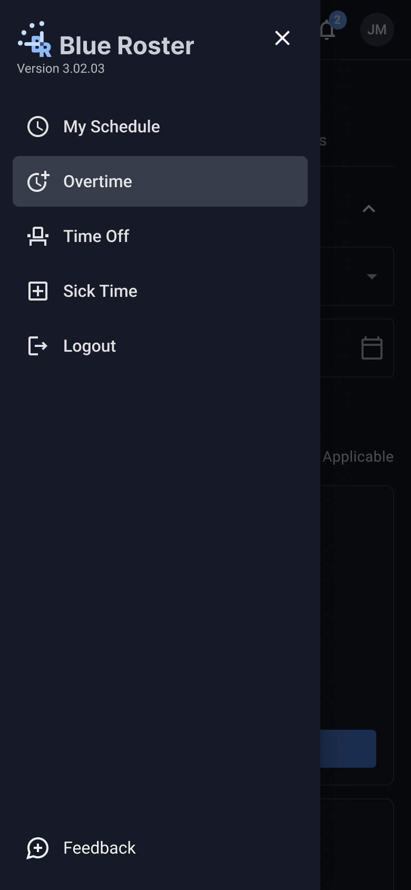
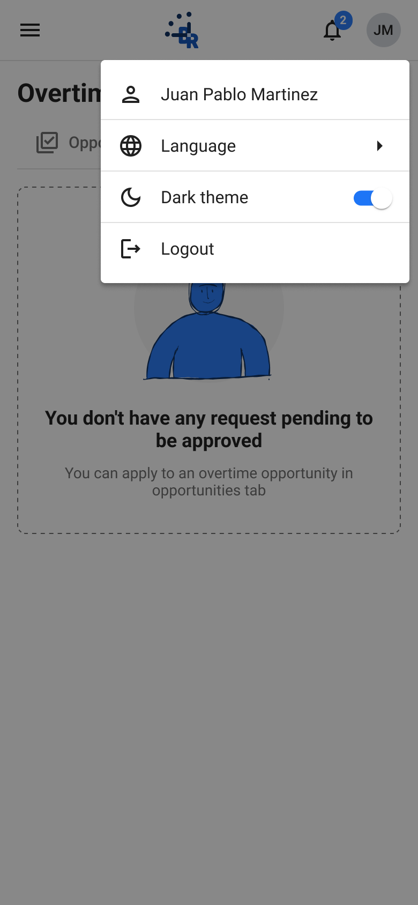
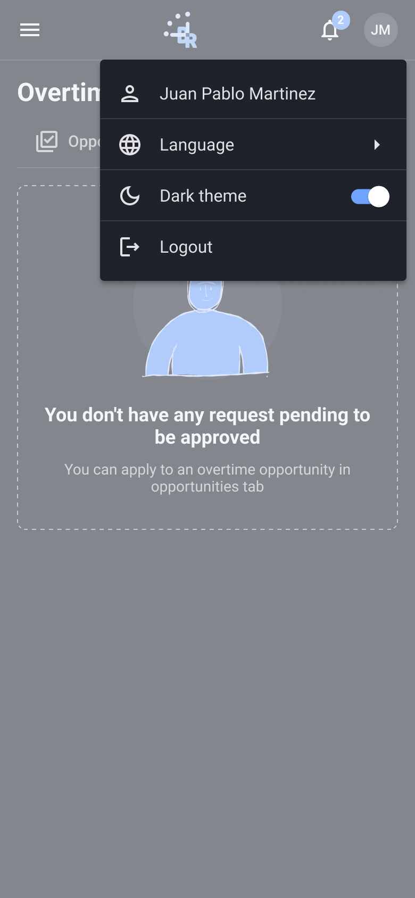
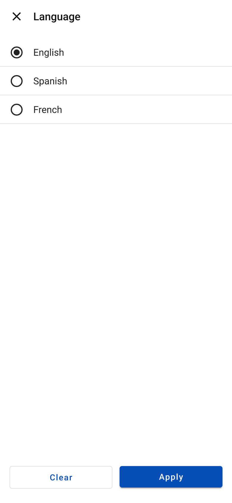
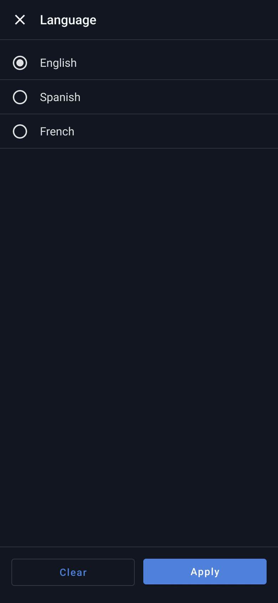

# Global overlays (avatar menu, language, notifications, nav drawer)

- **Platform:** Employee app · Mobile (390; tablet 768 where noted)
- **Shell:** `br-m-app-bar` + `br-m-nav-drawer`

## Components
br-m-app-bar, br-m-nav-drawer, br-menu-item, br-m-notifications-sheet

## Designed states / frames
- **Overtime · Nav drawer open**: [Light](https://www.figma.com/design/k05NWBKMjsvo5hEugQc2Tq/Design-System-Legacy?node-id=341-26373) 390×844 · [Dark](https://www.figma.com/design/k05NWBKMjsvo5hEugQc2Tq/Design-System-Legacy?node-id=341-26707) 390×844
- **Avatar menu open**: [Light](https://www.figma.com/design/k05NWBKMjsvo5hEugQc2Tq/Design-System-Legacy?node-id=373-7302) 390×844 · [Dark](https://www.figma.com/design/k05NWBKMjsvo5hEugQc2Tq/Design-System-Legacy?node-id=373-8418) 390×844
- **Language submenu**: [Light](https://www.figma.com/design/k05NWBKMjsvo5hEugQc2Tq/Design-System-Legacy?node-id=373-7412) 390×844 · [Dark](https://www.figma.com/design/k05NWBKMjsvo5hEugQc2Tq/Design-System-Legacy?node-id=373-8425) 390×844
- **Notifications open**: [Light](https://www.figma.com/design/k05NWBKMjsvo5hEugQc2Tq/Design-System-Legacy?node-id=373-7522) 390×844 · [Dark](https://www.figma.com/design/k05NWBKMjsvo5hEugQc2Tq/Design-System-Legacy?node-id=373-8431) 390×844

## Not designed yet
Loading, error, skeleton. Do not invent them silently; flag in the PR and follow README gaps.

## Visual reference

Exported from Figma (mobile at 2x, desktop/admin at 1x). Match these pixel-for-pixel before anything else.

**Overtime · Nav drawer open**

 

**Avatar menu open**

 

**Language submenu**

 

**Notifications open**

 

## Anatomy (extracted from the Light frame)

Order is top to bottom as in the Figma layer tree. x,y are relative to the parent. Paddings are top/right/bottom/left in px. Tokens are the variables bound in Figma. Full trimmed tree: see `json/`.

### Overtime · Nav drawer open (`341:26373`)

| Layer | Component / type | x,y | Size | Layout · tokens |
|---|---|---|---|---|
| App bar | `br-m-app-bar` | 0,0 | 390×57 | vertical, gap 0, padding 0/0/0/0; bg br/contrast |
| ↳ Row | `fram` | 0,0 | 390×56 | horizontal, gap 0, padding 0/8/0/4 |
| ↳ Divider | `rect` | 0,56 | 390×1 | bg br/component-border |
| Body | `fram` | 0,57 | 390×1017 | vertical, gap 16, padding 16/16/32/16 |
| ↳ Page header | `br-m-page-header` | 16,16 | 358×85 | vertical, gap 8, padding 0/0/0/0 |
| ↳ Filter bar | `br-m-filter-bar / State=Expanded` | 16,117 | 358×270 | vertical, gap 12, padding 0/0/0/0 |
| ↳ Cards | `fram` | 16,403 | 358×582 | vertical, gap 12, padding 0/0/0/0 |
| Scrim | `rect` | 0,0 | 390×844 | bg br/overlay-2; absolute |
| Nav drawer | `br-m-nav-drawer` | 0,0 | 304×844 | vertical, gap 4, padding 12/12/16/12; bg br/component-overlay-background; absolute |
| ↳ Brand row | `fram` | 12,12 | 280×60 | horizontal, gap 0, padding 0/0/0/0 |
| ↳ Spacer | `fram` | 12,76 | 10×16 | horizontal, gap 0, padding 0/0/0/0 |
| ↳ Nav | `fram` | 12,96 | 280×256 | vertical, gap 4, padding 0/0/0/0 |
| ↳ Fill | `fram` | 12,356 | 280×420 | horizontal, gap 0, padding 0/0/0/0 |
| ↳ Feedback | `fram` | 12,780 | 280×48 | horizontal, gap 12, padding 0/12/0/12 |

Node tree: [`json/global-overlays-avatar-menu-language-notifications-nav-drawer--overtime-nav-drawer-open.json`](json/global-overlays-avatar-menu-language-notifications-nav-drawer--overtime-nav-drawer-open.json)

### Avatar menu open (`373:7302`)

| Layer | Component / type | x,y | Size | Layout · tokens |
|---|---|---|---|---|
| App bar | `br-m-app-bar` | 0,0 | 390×57 | vertical, gap 0, padding 0/0/0/0; bg br/contrast |
| ↳ Row | `fram` | 0,0 | 390×56 | horizontal, gap 0, padding 0/8/0/4 |
| ↳ Divider | `rect` | 0,56 | 390×1 | bg br/component-border |
| Body | `fram` | 0,57 | 390×473 | vertical, gap 16, padding 16/16/32/16 |
| ↳ Page header | `br-m-page-header` | 16,16 | 358×85 | vertical, gap 8, padding 0/0/0/0 |
| ↳ Empty state | `br-m-empty-state` | 16,117 | 358×324 | vertical, gap 12, padding 32/24/32/24; border br/component-field-label; radius 8 |
| Scrim | `rect` | 0,0 | 390×844 | bg br/neutral-darkest; absolute |
| br-user-menu | `br-user-menu` | 94,56 | 288×208 | vertical, gap 0, padding 8/0/8/0; bg mat/menu-container-color; radius 4; absolute |
| ↳ User | `br-menu-item / Type=Default` | 0,8 | 288×48 | horizontal, gap 16, padding 0/16/0/16 |
| ↳ Language | `br-menu-item / Type=Submenu` | 0,56 | 288×48 | horizontal, gap 16, padding 0/16/0/16 |
| ↳ Dark theme | `br-menu-item / Type=Toggle` | 0,104 | 288×48 | horizontal, gap 16, padding 0/16/0/16 |
| ↳ Logout | `br-menu-item / Type=Default` | 0,152 | 288×48 | horizontal, gap 16, padding 0/16/0/16 |

Node tree: [`json/global-overlays-avatar-menu-language-notifications-nav-drawer--avatar-menu-open.json`](json/global-overlays-avatar-menu-language-notifications-nav-drawer--avatar-menu-open.json)

### Language submenu (`373:7412`)

| Layer | Component / type | x,y | Size | Layout · tokens |
|---|---|---|---|---|
| App bar | `br-m-app-bar` | 0,0 | 390×57 | vertical, gap 0, padding 0/0/0/0; bg br/contrast |
| ↳ Row | `fram` | 0,0 | 390×56 | horizontal, gap 0, padding 0/8/0/4 |
| ↳ Divider | `rect` | 0,56 | 390×1 | bg br/component-border |
| Body | `fram` | 0,57 | 390×473 | vertical, gap 16, padding 16/16/32/16 |
| ↳ Page header | `br-m-page-header` | 16,16 | 358×85 | vertical, gap 8, padding 0/0/0/0 |
| ↳ Empty state | `br-m-empty-state` | 16,117 | 358×324 | vertical, gap 12, padding 32/24/32/24; border br/component-field-label; radius 8 |
| br-m-option-sheet | `br-m-option-sheet` | 0,0 | 390×844 | vertical, gap 0, padding 0/0/0/0; bg br/contrast; absolute |
| ↳ Header | `fram` | 0,0 | 390×56 | horizontal, gap 16, padding 0/16/0/16; border br/divider |
| ↳ Options | `fram` | 0,56 | 390×709 | vertical, gap 0, padding 8/0/0/0 |
| ↳ Footer | `fram` | 0,765 | 390×79 | horizontal, gap 12, padding 16/16/24/16; border br/divider |

Node tree: [`json/global-overlays-avatar-menu-language-notifications-nav-drawer--language-submenu.json`](json/global-overlays-avatar-menu-language-notifications-nav-drawer--language-submenu.json)

### Notifications open (`373:7522`)

| Layer | Component / type | x,y | Size | Layout · tokens |
|---|---|---|---|---|
| App bar | `br-m-app-bar` | 0,0 | 390×57 | vertical, gap 0, padding 0/0/0/0; bg br/contrast |
| ↳ Row | `fram` | 0,0 | 390×56 | horizontal, gap 0, padding 0/8/0/4 |
| ↳ Divider | `rect` | 0,56 | 390×1 | bg br/component-border |
| Body | `fram` | 0,57 | 390×473 | vertical, gap 16, padding 16/16/32/16 |
| ↳ Page header | `br-m-page-header` | 16,16 | 358×85 | vertical, gap 8, padding 0/0/0/0 |
| ↳ Empty state | `br-m-empty-state` | 16,117 | 358×324 | vertical, gap 12, padding 32/24/32/24; border br/component-field-label; radius 8 |
| br-m-notifications-sheet | `br-m-notifications-sheet` | 0,0 | 390×844 | vertical, gap 0, padding 0/0/0/0; bg br/contrast; absolute |
| ↳ Header | `fram` | 0,0 | 390×56 | horizontal, gap 16, padding 0/16/0/16; border br/divider |
| ↳ Body | `fram` | 0,56 | 390×88 | vertical, gap 16, padding 16/16/0/16 |

Node tree: [`json/global-overlays-avatar-menu-language-notifications-nav-drawer--notifications-open.json`](json/global-overlays-avatar-menu-language-notifications-nav-drawer--notifications-open.json)

