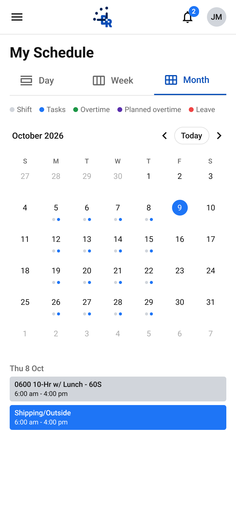
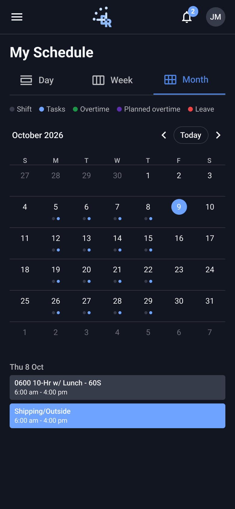

# My Schedule · Month

- **Platform:** Employee app · Mobile (390; tablet 768 where noted)
- **Shell:** `br-m-app-bar` + `br-m-nav-drawer`

## Components
br-m-date-nav, br-m-month-cell, br-m-legend

## Designed states / frames
- **My Schedule · Month**: [Light](https://www.figma.com/design/k05NWBKMjsvo5hEugQc2Tq/Design-System-Legacy?node-id=372-5618) 390×844 · [Dark](https://www.figma.com/design/k05NWBKMjsvo5hEugQc2Tq/Design-System-Legacy?node-id=372-6446) 390×844

## Not designed yet
Loading, error, skeleton. Do not invent them silently; flag in the PR and follow README gaps.

## Detailed anatomy (top to bottom, 390×844)

Read with `tokens/events.md`, `tokens/typography.md`, `patterns/formats.md`, `patterns/calendar-layout.md`. Starter markup: `starter/`. Sample data: `fixtures/schedule.json`.

| # | Block | Component | Size | Padding t/r/b/l · gap | Contents and alignment | Fixed / scroll |
|---|---|---|---|---|---|---|
| 1 | App bar | `br-m-app-bar` | 390×57 | row 56: 0/8/0/4 · bottom divider 1px `--br-component-border` | **Left:** menu icon button 48×48 (`menu`, 24, `--br-neutral-darkest`). **Centre:** `br-logo` Isotype 32×34 at x 153. **Right:** notifications 48×48 with badge (17×18, r9, `--br-primary`, count Roboto Bold 11) + account 48×48 with 32px initials avatar (`--br-neutral-light`, "JM" Roboto Medium 13). Bg `--br-contrast`. | fixed (outside Body) |
| 2 | Body | frame | 390 wide | 16/16/32/16 · gap 16 | Holds rows 3–6. Bg `--br-contrast`. | scrolls |
| 3 | Page header | `br-m-page-header` | 358×85 | gap 8 | Title "My Schedule" Roboto Bold 24 (28 tall), left. Tabs strip 48 + 1px divider: 3 equal `br-page-tab` (≈119 wide, padding 0 16, gap 8, icon 24 + label Roboto Medium 15). Active: `--br-primary-dark` text/icon + 2px bottom border; default `--br-text-label`. | in flow (sticky TBD) |
| 4 | Legend | `br-m-legend` | 358×14 | gap 12 between items, 4 dot→label | Shift · Tasks · Overtime · Planned overtime · Leave; 8px dots; Roboto Regular 12 `--br-text-label`. Left aligned. | in flow |
| 5 | Date nav | `br-m-date-nav` | 358×40 | 0/0/0/4 · gap 4 | **Left:** label Roboto Medium 14 (fills width). **Right:** `chevron_left` 24 · **Today** pill (padding 6/10, 1px `--br-component-border`, r16, Roboto Medium 13) · `chevron_right` 24. | in flow |
| 6 | Calendar | frame | 358×325 | — | Weekday initials row 13px (S M T W T F S, Roboto Medium 11 `--br-text-label`, centered, 7 × ≈51). Grid 6 weeks × 52: `br-m-month-cell` 51×52, 1px top border `--br-divider`, padding-top 4, gap 4, 26px day circle (Roboto Regular 13), dots row. Sep 27–30 / Nov days = Outside (`--br-component-disabled`). Oct 9 = Today. Mon–Thu of every week show Shift + Task dots. | in flow |
| 7 | Selected day agenda | frame | 358×109 | gap 6 | "Thu 8 Oct" heading + Shift and Task blocks (358×41), as in Week. Sits 16px under the calendar (y 544). | scrolls |

Date nav label: "October 2026".

## Visual reference

Exported from Figma (mobile at 2x, desktop/admin at 1x). Match these pixel-for-pixel before anything else.

**My Schedule · Month**

 

## Anatomy (extracted from the Light frame)

Order is top to bottom as in the Figma layer tree. x,y are relative to the parent. Paddings are top/right/bottom/left in px. Tokens are the variables bound in Figma. Full trimmed tree: see `json/`.

### My Schedule · Month (`372:5618`)

| Layer | Component / type | x,y | Size | Layout · tokens |
|---|---|---|---|---|
| App bar | `br-m-app-bar` | 0,0 | 390×57 | vertical, gap 0, padding 0/0/0/0; bg br/contrast |
| ↳ Row | `fram` | 0,0 | 390×56 | horizontal, gap 0, padding 0/8/0/4 |
| ↳ Divider | `rect` | 0,56 | 390×1 | bg br/component-border |
| Body | `fram` | 0,57 | 390×685 | vertical, gap 16, padding 16/16/32/16 |
| ↳ Page header | `br-m-page-header` | 16,16 | 358×85 | vertical, gap 8, padding 0/0/0/0 |
| ↳ Legend | `br-m-legend` | 16,117 | 358×14 | horizontal, gap 12, padding 0/0/0/0 |
| ↳ Date nav | `br-m-date-nav` | 16,147 | 358×40 | horizontal, gap 4, padding 0/0/0/4 |
| ↳ Calendar | `fram` | 16,203 | 358×325 | vertical, gap 0, padding 0/0/0/0 |
| ↳ Thu 8 Oct | `fram` | 16,544 | 358×109 | vertical, gap 6, padding 0/0/0/0 |

Node tree: [`json/my-schedule-month.json`](json/my-schedule-month.json)

