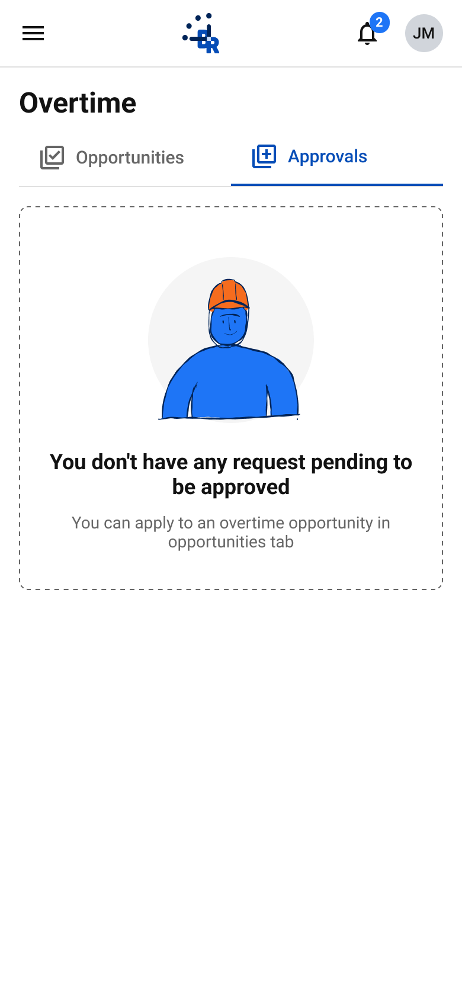
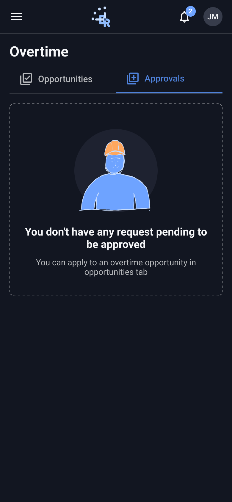
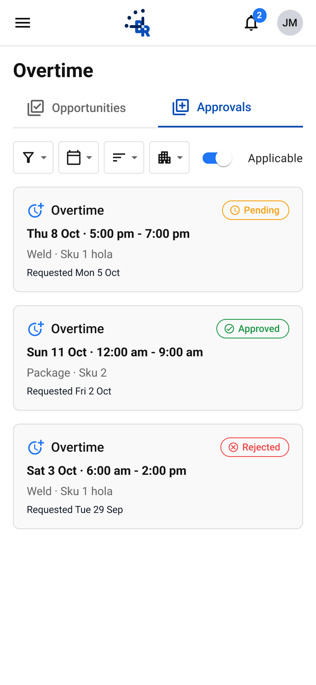
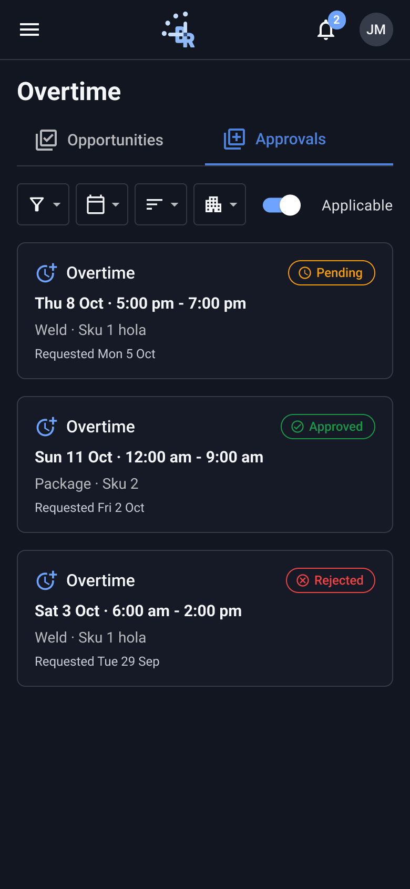

# Overtime · Approvals

- **Platform:** Employee app · Mobile (390; tablet 768 where noted)
- **Shell:** `br-m-app-bar` + `br-m-nav-drawer`

## Components
br-m-app-bar, br-m-page-header, br-m-request-card, br-m-status-pill, br-m-empty-state

## Designed states / frames
- **Overtime · Approvals · Empty**: [Light](https://www.figma.com/design/k05NWBKMjsvo5hEugQc2Tq/Design-System-Legacy?node-id=341-934) 390×844 · [Dark](https://www.figma.com/design/k05NWBKMjsvo5hEugQc2Tq/Design-System-Legacy?node-id=341-1172) 390×844
- **Overtime · Approvals**: [Light](https://www.figma.com/design/k05NWBKMjsvo5hEugQc2Tq/Design-System-Legacy?node-id=373-6524) 390×844 · [Dark](https://www.figma.com/design/k05NWBKMjsvo5hEugQc2Tq/Design-System-Legacy?node-id=373-8363) 390×844

## Not designed yet
Loading, error, skeleton. Do not invent them silently; flag in the PR and follow README gaps.

## Visual reference

Exported from Figma (mobile at 2x, desktop/admin at 1x). Match these pixel-for-pixel before anything else.

**Overtime · Approvals · Empty**

 

**Overtime · Approvals**

 

## Anatomy (extracted from the Light frame)

Order is top to bottom as in the Figma layer tree. x,y are relative to the parent. Paddings are top/right/bottom/left in px. Tokens are the variables bound in Figma. Full trimmed tree: see `json/`.

### Overtime · Approvals · Empty (`341:934`)

| Layer | Component / type | x,y | Size | Layout · tokens |
|---|---|---|---|---|
| App bar | `br-m-app-bar` | 0,0 | 390×57 | vertical, gap 0, padding 0/0/0/0; bg br/contrast |
| ↳ Row | `fram` | 0,0 | 390×56 | horizontal, gap 0, padding 0/8/0/4 |
| ↳ Divider | `rect` | 0,56 | 390×1 | bg br/component-border |
| Body | `fram` | 0,57 | 390×473 | vertical, gap 16, padding 16/16/32/16 |
| ↳ Page header | `br-m-page-header` | 16,16 | 358×85 | vertical, gap 8, padding 0/0/0/0 |
| ↳ Empty state | `br-m-empty-state` | 16,117 | 358×324 | vertical, gap 12, padding 32/24/32/24; border br/component-field-label; radius 8 |

Node tree: [`json/overtime-approvals--overtime-approvals-empty.json`](json/overtime-approvals--overtime-approvals-empty.json)

### Overtime · Approvals (`373:6524`)

| Layer | Component / type | x,y | Size | Layout · tokens |
|---|---|---|---|---|
| App bar | `br-m-app-bar` | 0,0 | 390×57 | vertical, gap 0, padding 0/0/0/0; bg br/contrast |
| ↳ Row | `fram` | 0,0 | 390×56 | horizontal, gap 0, padding 0/8/0/4 |
| ↳ Divider | `rect` | 0,56 | 390×1 | bg br/component-border |
| Body | `fram` | 0,57 | 390×627 | vertical, gap 16, padding 16/16/32/16 |
| ↳ Page header | `br-m-page-header` | 16,16 | 358×85 | vertical, gap 8, padding 0/0/0/0 |
| ↳ Compact filters | `br-m-filter-compact` | 16,117 | 358×40 | horizontal, gap 6, padding 0/0/0/0 |
| ↳ Req 1 | `br-m-request-card` | 16,173 | 358×130 | vertical, gap 8, padding 16/16/16/16; bg br/neutral-white; border br/component-border; radius 8 |
| ↳ Req 2 | `br-m-request-card` | 16,319 | 358×130 | vertical, gap 8, padding 16/16/16/16; bg br/neutral-white; border br/component-border; radius 8 |
| ↳ Req 3 | `br-m-request-card` | 16,465 | 358×130 | vertical, gap 8, padding 16/16/16/16; bg br/neutral-white; border br/component-border; radius 8 |

Node tree: [`json/overtime-approvals--overtime-approvals.json`](json/overtime-approvals--overtime-approvals.json)

