# Overtime · Opportunities

- **Platform:** Employee app · Mobile (390; tablet 768 where noted)
- **Shell:** `br-m-app-bar` + `br-m-nav-drawer`

## Components
br-m-app-bar, br-m-page-header, br-filter-button, br-filter-dialog (4+ filters), br-overtime-card, br-m-empty-state, br-m-option-sheet, br-m-date-range-sheet, br-chip; content: br-content-overtime-opportunities-filter-button / -inline

## Designed states / frames
- **Overtime · Opportunities**: [Light](https://www.figma.com/design/k05NWBKMjsvo5hEugQc2Tq/Design-System-Legacy?node-id=341-331) 390×1736 · [Dark](https://www.figma.com/design/k05NWBKMjsvo5hEugQc2Tq/Design-System-Legacy?node-id=341-503) 390×1736
- **Overtime · Opportunities · Sticky filters**: [Light](https://www.figma.com/design/k05NWBKMjsvo5hEugQc2Tq/Design-System-Legacy?node-id=341-677) 390×844 · [Dark](https://www.figma.com/design/k05NWBKMjsvo5hEugQc2Tq/Design-System-Legacy?node-id=341-1153) 390×844
- **Overtime · Opportunities · Empty**: [Light](https://www.figma.com/design/k05NWBKMjsvo5hEugQc2Tq/Design-System-Legacy?node-id=341-801) 390×844 · [Dark](https://www.figma.com/design/k05NWBKMjsvo5hEugQc2Tq/Design-System-Legacy?node-id=341-1165) 390×844
- **Overtime · Opportunities · Tablet 768**: [Light](https://www.figma.com/design/k05NWBKMjsvo5hEugQc2Tq/Design-System-Legacy?node-id=341-26535) 768×1154 · [Dark](https://www.figma.com/design/k05NWBKMjsvo5hEugQc2Tq/Design-System-Legacy?node-id=341-26718) 768×1154
- **Overtime · A1 · Filter collapsed**: [Light](https://www.figma.com/design/k05NWBKMjsvo5hEugQc2Tq/Design-System-Legacy?node-id=365-27507) 390×844 · [Dark](https://www.figma.com/design/k05NWBKMjsvo5hEugQc2Tq/Design-System-Legacy?node-id=365-27593) 390×844
- **Overtime · A2 · Filter expanded**: [Light](https://www.figma.com/design/k05NWBKMjsvo5hEugQc2Tq/Design-System-Legacy?node-id=365-27679) 390×844 · [Dark](https://www.figma.com/design/k05NWBKMjsvo5hEugQc2Tq/Design-System-Legacy?node-id=365-27793) 390×844
- **Overtime · B1 · Compact filters**: [Light](https://www.figma.com/design/k05NWBKMjsvo5hEugQc2Tq/Design-System-Legacy?node-id=365-27907) 390×844 · [Dark](https://www.figma.com/design/k05NWBKMjsvo5hEugQc2Tq/Design-System-Legacy?node-id=365-28014) 390×844
- **Overtime · B2 · Sort sheet open**: [Light](https://www.figma.com/design/k05NWBKMjsvo5hEugQc2Tq/Design-System-Legacy?node-id=365-28121) 390×844 · [Dark](https://www.figma.com/design/k05NWBKMjsvo5hEugQc2Tq/Design-System-Legacy?node-id=365-28271) 390×844
- **Overtime · B3 · Department sheet open**: [Light](https://www.figma.com/design/k05NWBKMjsvo5hEugQc2Tq/Design-System-Legacy?node-id=365-28421) 390×844 · [Dark](https://www.figma.com/design/k05NWBKMjsvo5hEugQc2Tq/Design-System-Legacy?node-id=365-28571) 390×844
- **Overtime · B4 · Date range sheet open**: [Light](https://www.figma.com/design/k05NWBKMjsvo5hEugQc2Tq/Design-System-Legacy?node-id=368-29380) 390×844 · [Dark](https://www.figma.com/design/k05NWBKMjsvo5hEugQc2Tq/Design-System-Legacy?node-id=368-29601) 390×844
- **Overtime · Filters button · Mobile**: [Light](https://www.figma.com/design/k05NWBKMjsvo5hEugQc2Tq/Design-System-Legacy?node-id=394-8715) 390×844 · [Dark](https://www.figma.com/design/k05NWBKMjsvo5hEugQc2Tq/Design-System-Legacy?node-id=394-9740) 390×844
- **Overtime · Filters dialog open · Mobile**: [Light](https://www.figma.com/design/k05NWBKMjsvo5hEugQc2Tq/Design-System-Legacy?node-id=394-8801) 390×844 · [Dark](https://www.figma.com/design/k05NWBKMjsvo5hEugQc2Tq/Design-System-Legacy?node-id=394-9751) 390×844

## Not designed yet
Loading, error, skeleton. Do not invent them silently; flag in the PR and follow README gaps.

## Visual reference

Exported from Figma (mobile at 2x, desktop/admin at 1x). Match these pixel-for-pixel before anything else.

**Overtime · Opportunities**

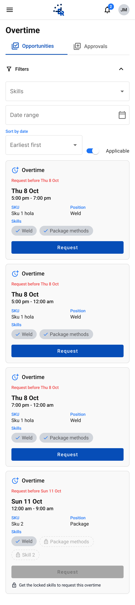 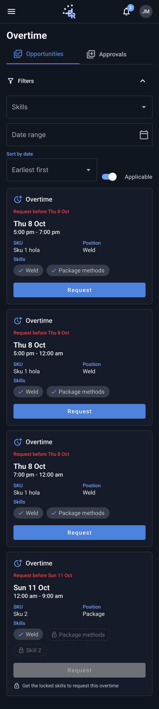

**Overtime · Opportunities · Sticky filters**

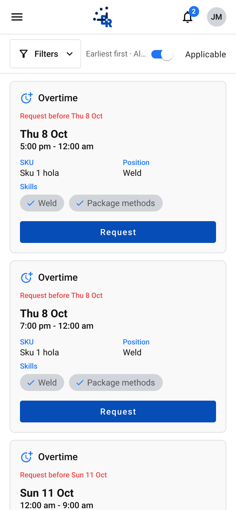 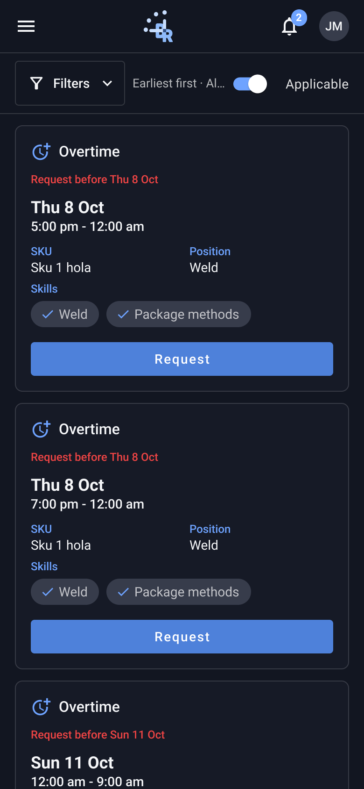

**Overtime · Opportunities · Empty**

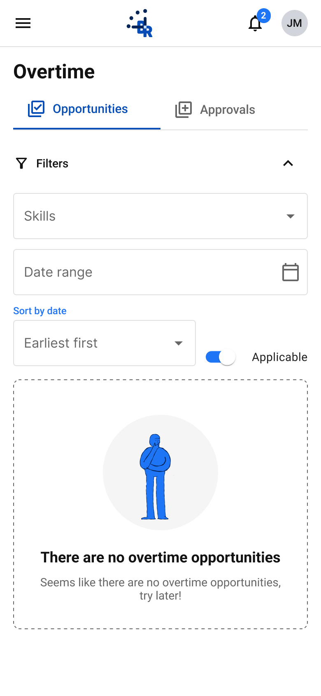 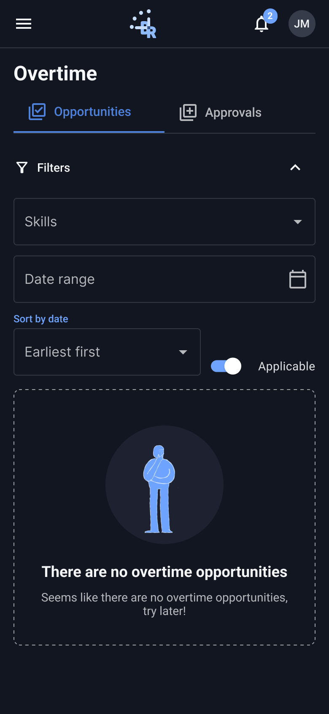

**Overtime · Opportunities · Tablet 768**

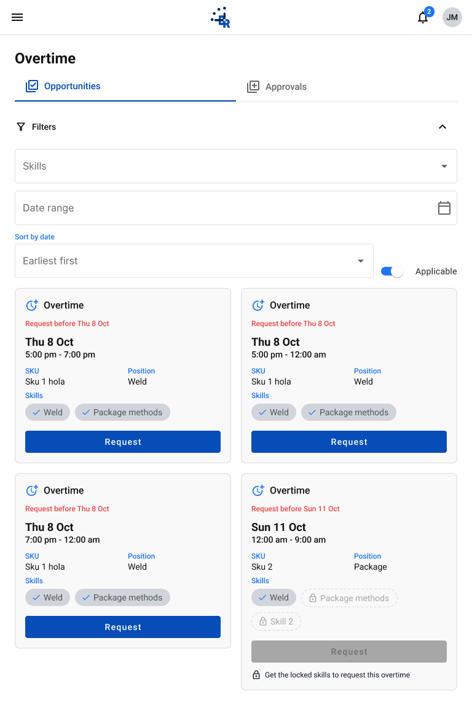 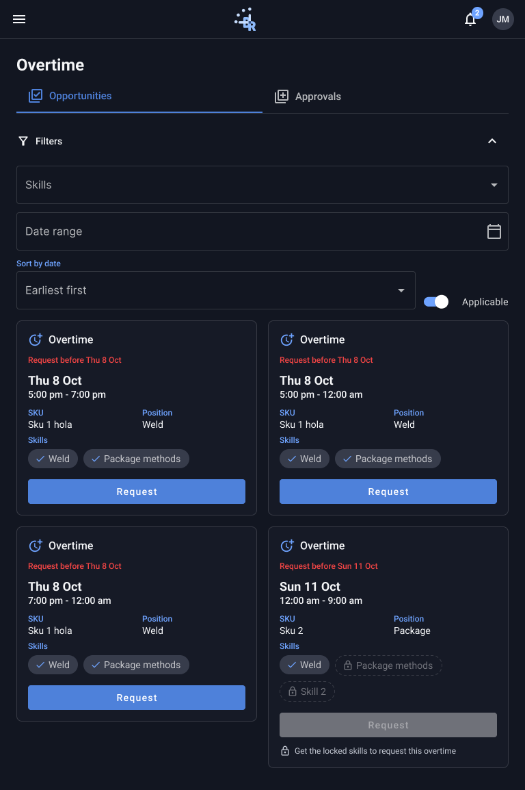

**Overtime · A1 · Filter collapsed**

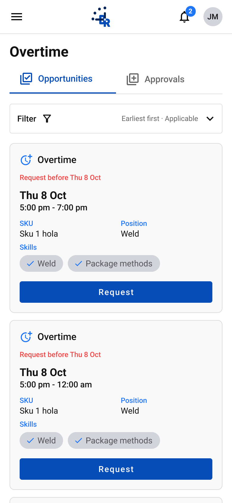 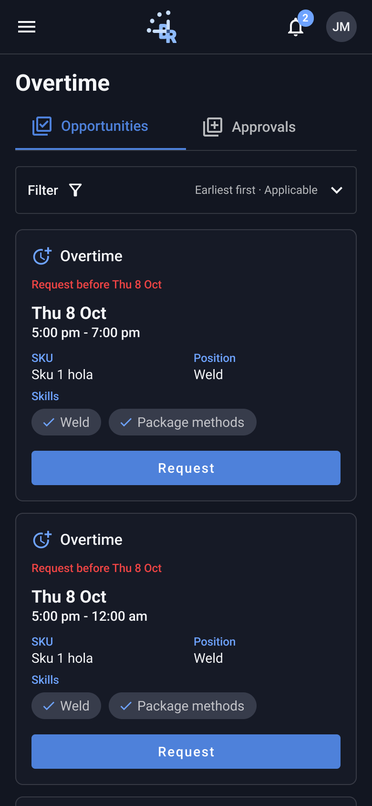

**Overtime · A2 · Filter expanded**

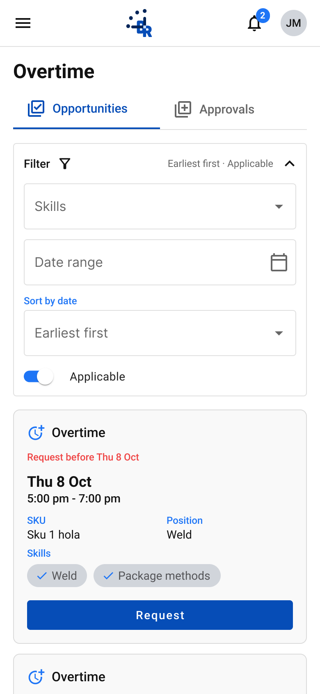 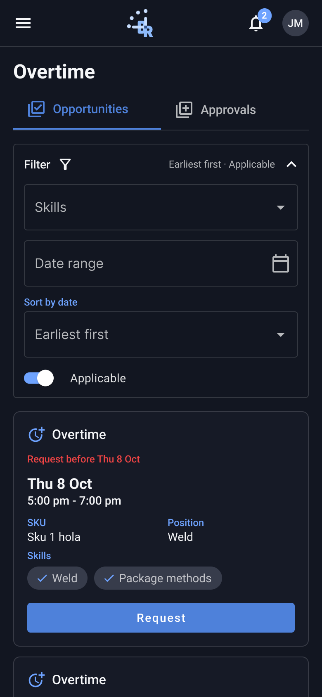

**Overtime · B1 · Compact filters**

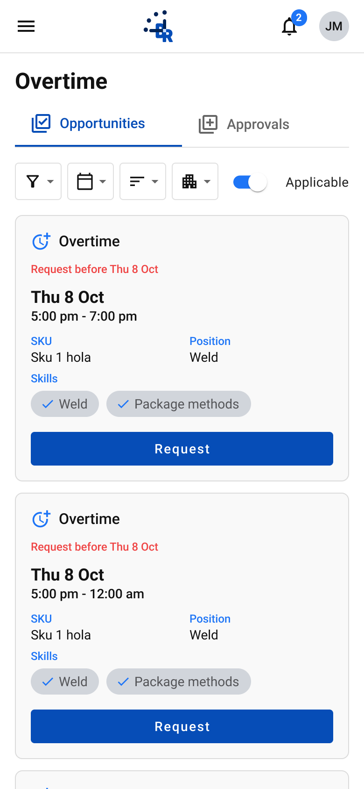 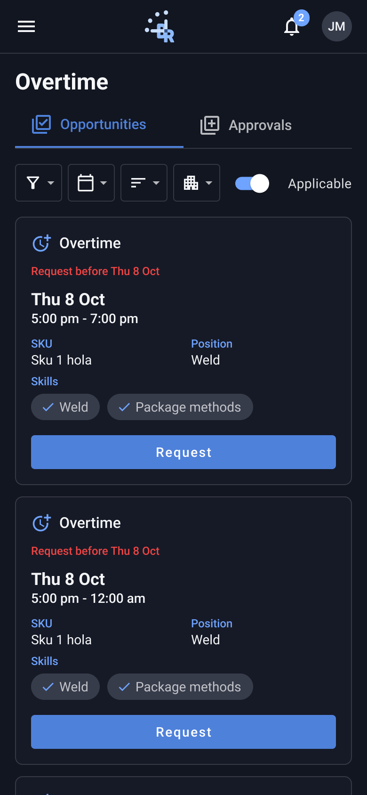

**Overtime · B2 · Sort sheet open**

 

**Overtime · B3 · Department sheet open**

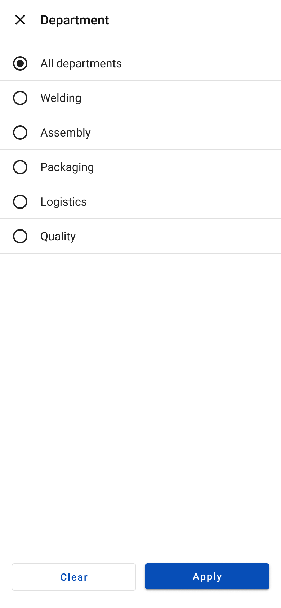 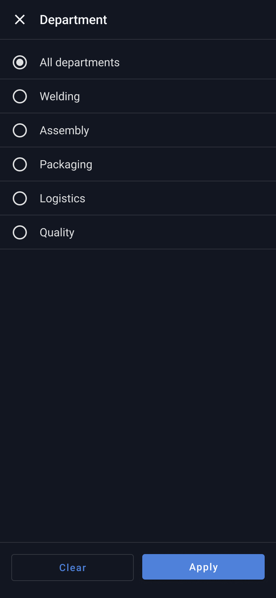

**Overtime · B4 · Date range sheet open**

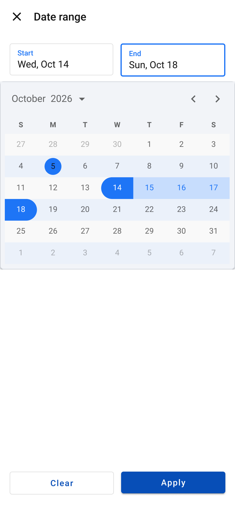 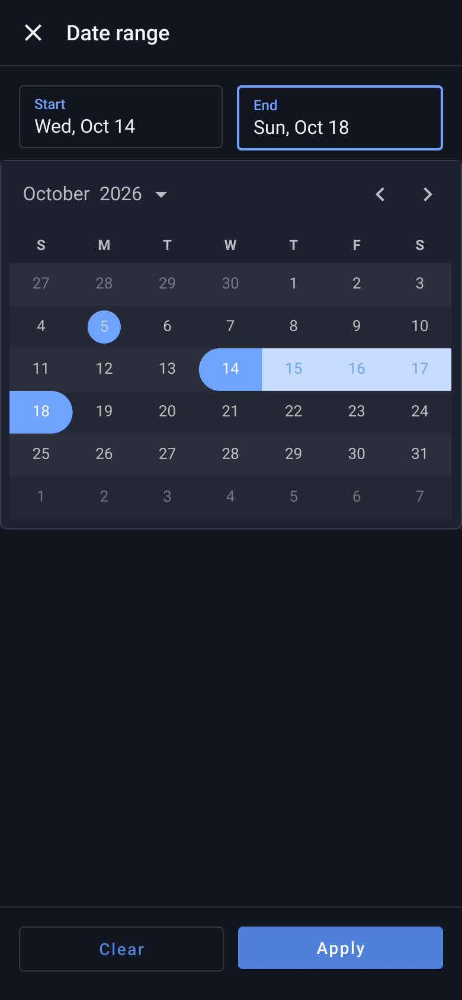

**Overtime · Filters button · Mobile**

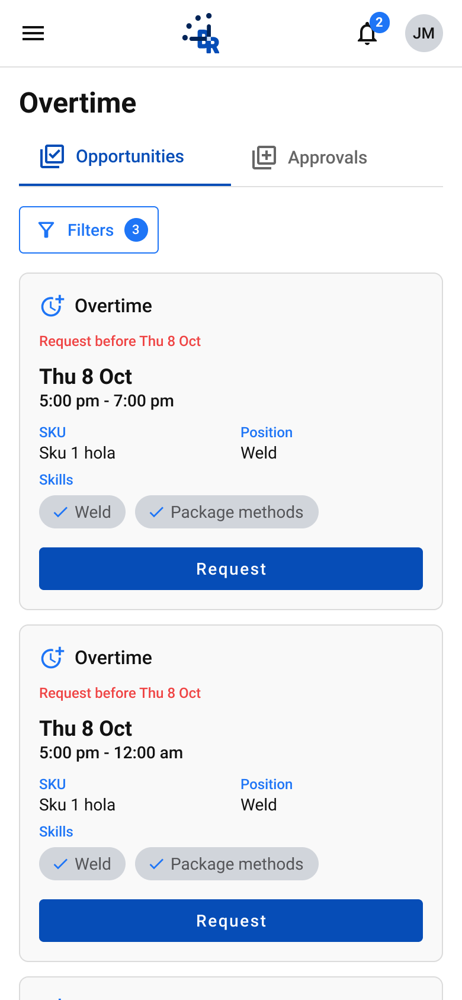 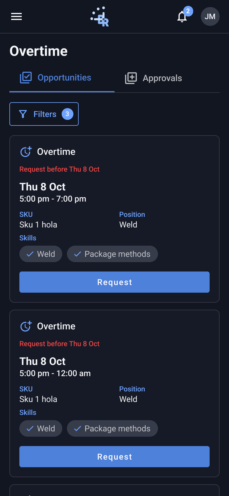

**Overtime · Filters dialog open · Mobile**

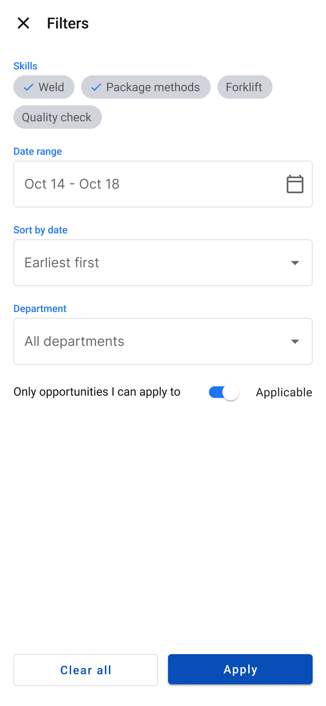 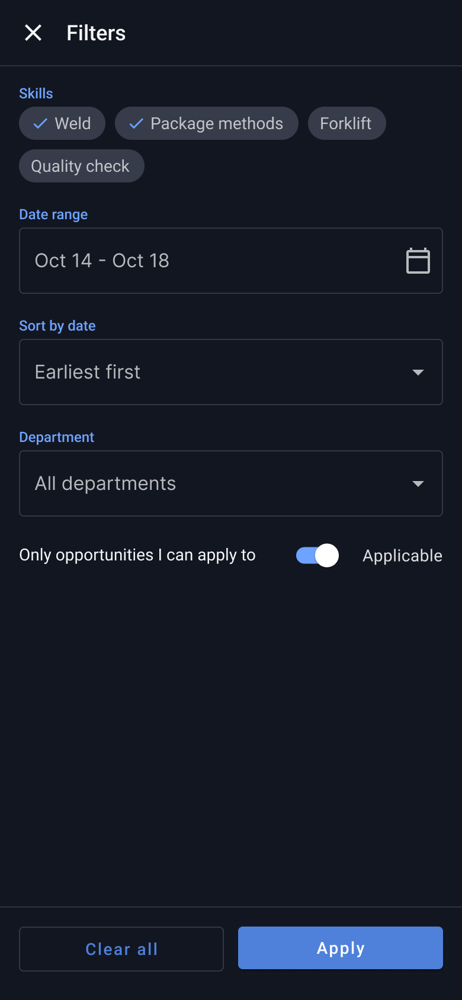

## Anatomy (extracted from the Light frame)

Order is top to bottom as in the Figma layer tree. x,y are relative to the parent. Paddings are top/right/bottom/left in px. Tokens are the variables bound in Figma. Full trimmed tree: see `json/`.

### Overtime · Opportunities (`341:331`)

| Layer | Component / type | x,y | Size | Layout · tokens |
|---|---|---|---|---|
| App bar | `br-m-app-bar` | 0,0 | 390×57 | vertical, gap 0, padding 0/0/0/0; bg br/contrast |
| ↳ Row | `fram` | 0,0 | 390×56 | horizontal, gap 0, padding 0/8/0/4 |
| ↳ Divider | `rect` | 0,56 | 390×1 | bg br/component-border |
| Body | `fram` | 0,57 | 390×1679 | vertical, gap 16, padding 16/16/32/16 |
| ↳ Page header | `br-m-page-header` | 16,16 | 358×85 | vertical, gap 8, padding 0/0/0/0 |
| ↳ Filter bar | `br-m-filter-bar / State=Expanded` | 16,117 | 358×270 | vertical, gap 12, padding 0/0/0/0 |
| ↳ Cards | `fram` | 16,403 | 358×1244 | vertical, gap 12, padding 0/0/0/0 |

Node tree: [`json/overtime-opportunities--overtime-opportunities.json`](json/overtime-opportunities--overtime-opportunities.json)

### Overtime · Opportunities · Sticky filters (`341:677`)

| Layer | Component / type | x,y | Size | Layout · tokens |
|---|---|---|---|---|
| App bar | `br-m-app-bar` | 0,0 | 390×57 | vertical, gap 0, padding 0/0/0/0; bg br/contrast |
| ↳ Row | `fram` | 0,0 | 390×56 | horizontal, gap 0, padding 0/8/0/4 |
| ↳ Divider | `rect` | 0,56 | 390×1 | bg br/component-border |
| Sticky · collapsed filters | `fram` | 0,57 | 390×65 | vertical, gap 0, padding 0/0/0/0; bg br/contrast |
| ↳ Inner | `fram` | 0,0 | 390×64 | vertical, gap 0, padding 8/16/8/16 |
| ↳ Divider | `rect` | 0,64 | 390×1 | bg br/component-border |
| Body | `fram` | 0,122 | 390×991 | vertical, gap 16, padding 12/16/32/16 |
| ↳ Cards | `fram` | 16,12 | 358×947 | vertical, gap 12, padding 0/0/0/0 |

Node tree: [`json/overtime-opportunities--overtime-opportunities-sticky-filters.json`](json/overtime-opportunities--overtime-opportunities-sticky-filters.json)

### Overtime · Opportunities · Empty (`341:801`)

| Layer | Component / type | x,y | Size | Layout · tokens |
|---|---|---|---|---|
| App bar | `br-m-app-bar` | 0,0 | 390×57 | vertical, gap 0, padding 0/0/0/0; bg br/contrast |
| ↳ Row | `fram` | 0,0 | 390×56 | horizontal, gap 0, padding 0/8/0/4 |
| ↳ Divider | `rect` | 0,56 | 390×1 | bg br/component-border |
| Body | `fram` | 0,57 | 390×738 | vertical, gap 16, padding 16/16/32/16 |
| ↳ Page header | `br-m-page-header` | 16,16 | 358×85 | vertical, gap 8, padding 0/0/0/0 |
| ↳ Filter bar | `br-m-filter-bar / State=Expanded` | 16,117 | 358×270 | vertical, gap 12, padding 0/0/0/0 |
| ↳ Empty state | `br-m-empty-state` | 16,403 | 358×303 | vertical, gap 12, padding 32/24/32/24; border br/component-field-label; radius 8 |

Node tree: [`json/overtime-opportunities--overtime-opportunities-empty.json`](json/overtime-opportunities--overtime-opportunities-empty.json)

### Overtime · Opportunities · Tablet 768 (`341:26535`)

| Layer | Component / type | x,y | Size | Layout · tokens |
|---|---|---|---|---|
| App bar | `br-m-app-bar` | 0,0 | 768×57 | vertical, gap 0, padding 0/0/0/0; bg br/contrast |
| ↳ Row | `fram` | 0,0 | 768×56 | horizontal, gap 0, padding 0/8/0/4 |
| ↳ Divider | `rect` | 0,56 | 768×1 | bg br/component-border |
| Body | `fram` | 0,57 | 768×1097 | vertical, gap 16, padding 24/24/32/24 |
| ↳ Page header | `br-m-page-header` | 24,24 | 720×85 | vertical, gap 8, padding 0/0/0/0 |
| ↳ Filter bar | `br-m-filter-bar / State=Expanded` | 24,125 | 720×270 | vertical, gap 12, padding 0/0/0/0 |
| ↳ Cards | `fram` | 24,411 | 720×654 | horizontal, gap 16, padding 0/0/0/0 |

Node tree: [`json/overtime-opportunities--overtime-opportunities-tablet-768.json`](json/overtime-opportunities--overtime-opportunities-tablet-768.json)

### Overtime · A1 · Filter collapsed (`365:27507`)

| Layer | Component / type | x,y | Size | Layout · tokens |
|---|---|---|---|---|
| App bar | `br-m-app-bar` | 0,0 | 390×57 | vertical, gap 0, padding 0/0/0/0; bg br/contrast |
| ↳ Row | `fram` | 0,0 | 390×56 | horizontal, gap 0, padding 0/8/0/4 |
| ↳ Divider | `rect` | 0,56 | 390×1 | bg br/component-border |
| Body | `fram` | 0,57 | 390×1459 | vertical, gap 16, padding 16/16/32/16 |
| ↳ Page header | `br-m-page-header` | 16,16 | 358×85 | vertical, gap 8, padding 0/0/0/0 |
| ↳ Filter accordion | `br-m-filter-accordion / State=Collapsed` | 16,117 | 358×50 | vertical, gap 0, padding 0/0/0/0; bg br/contrast; border br/component-border; radius 4 |
| ↳ Cards | `fram` | 16,183 | 358×1244 | vertical, gap 12, padding 0/0/0/0 |

Node tree: [`json/overtime-opportunities--overtime-a1-filter-collapsed.json`](json/overtime-opportunities--overtime-a1-filter-collapsed.json)

### Overtime · A2 · Filter expanded (`365:27679`)

| Layer | Component / type | x,y | Size | Layout · tokens |
|---|---|---|---|---|
| App bar | `br-m-app-bar` | 0,0 | 390×57 | vertical, gap 0, padding 0/0/0/0; bg br/contrast |
| ↳ Row | `fram` | 0,0 | 390×56 | horizontal, gap 0, padding 0/8/0/4 |
| ↳ Divider | `rect` | 0,56 | 390×1 | bg br/component-border |
| Body | `fram` | 0,57 | 390×1717 | vertical, gap 16, padding 16/16/32/16 |
| ↳ Page header | `br-m-page-header` | 16,16 | 358×85 | vertical, gap 8, padding 0/0/0/0 |
| ↳ Filter accordion | `br-m-filter-accordion / State=Expanded` | 16,117 | 358×308 | vertical, gap 0, padding 0/0/0/0; bg br/contrast; border br/component-border; radius 4 |
| ↳ Cards | `fram` | 16,441 | 358×1244 | vertical, gap 12, padding 0/0/0/0 |

Node tree: [`json/overtime-opportunities--overtime-a2-filter-expanded.json`](json/overtime-opportunities--overtime-a2-filter-expanded.json)

### Overtime · B1 · Compact filters (`365:27907`)

| Layer | Component / type | x,y | Size | Layout · tokens |
|---|---|---|---|---|
| App bar | `br-m-app-bar` | 0,0 | 390×57 | vertical, gap 0, padding 0/0/0/0; bg br/contrast |
| ↳ Row | `fram` | 0,0 | 390×56 | horizontal, gap 0, padding 0/8/0/4 |
| ↳ Divider | `rect` | 0,56 | 390×1 | bg br/component-border |
| Body | `fram` | 0,57 | 390×1449 | vertical, gap 16, padding 16/16/32/16 |
| ↳ Page header | `br-m-page-header` | 16,16 | 358×85 | vertical, gap 8, padding 0/0/0/0 |
| ↳ Compact filters | `br-m-filter-compact` | 16,117 | 358×40 | horizontal, gap 6, padding 0/0/0/0 |
| ↳ Cards | `fram` | 16,173 | 358×1244 | vertical, gap 12, padding 0/0/0/0 |

Node tree: [`json/overtime-opportunities--overtime-b1-compact-filters.json`](json/overtime-opportunities--overtime-b1-compact-filters.json)

### Overtime · B2 · Sort sheet open (`365:28121`)

| Layer | Component / type | x,y | Size | Layout · tokens |
|---|---|---|---|---|
| App bar | `br-m-app-bar` | 0,0 | 390×57 | vertical, gap 0, padding 0/0/0/0; bg br/contrast |
| ↳ Row | `fram` | 0,0 | 390×56 | horizontal, gap 0, padding 0/8/0/4 |
| ↳ Divider | `rect` | 0,56 | 390×1 | bg br/component-border |
| Body | `fram` | 0,57 | 390×1449 | vertical, gap 16, padding 16/16/32/16 |
| ↳ Page header | `br-m-page-header` | 16,16 | 358×85 | vertical, gap 8, padding 0/0/0/0 |
| ↳ Compact filters | `br-m-filter-compact` | 16,117 | 358×40 | horizontal, gap 6, padding 0/0/0/0 |
| ↳ Cards | `fram` | 16,173 | 358×1244 | vertical, gap 12, padding 0/0/0/0 |
| Sort sheet | `br-m-option-sheet` | 0,0 | 390×844 | vertical, gap 0, padding 0/0/0/0; bg br/contrast; absolute |
| ↳ Header | `fram` | 0,0 | 390×56 | horizontal, gap 16, padding 0/16/0/16; border br/divider |
| ↳ Options | `fram` | 0,56 | 390×709 | vertical, gap 0, padding 8/0/0/0 |
| ↳ Footer | `fram` | 0,765 | 390×79 | horizontal, gap 12, padding 16/16/24/16; border br/divider |

Node tree: [`json/overtime-opportunities--overtime-b2-sort-sheet-open.json`](json/overtime-opportunities--overtime-b2-sort-sheet-open.json)

### Overtime · B3 · Department sheet open (`365:28421`)

| Layer | Component / type | x,y | Size | Layout · tokens |
|---|---|---|---|---|
| App bar | `br-m-app-bar` | 0,0 | 390×57 | vertical, gap 0, padding 0/0/0/0; bg br/contrast |
| ↳ Row | `fram` | 0,0 | 390×56 | horizontal, gap 0, padding 0/8/0/4 |
| ↳ Divider | `rect` | 0,56 | 390×1 | bg br/component-border |
| Body | `fram` | 0,57 | 390×1449 | vertical, gap 16, padding 16/16/32/16 |
| ↳ Page header | `br-m-page-header` | 16,16 | 358×85 | vertical, gap 8, padding 0/0/0/0 |
| ↳ Compact filters | `br-m-filter-compact` | 16,117 | 358×40 | horizontal, gap 6, padding 0/0/0/0 |
| ↳ Cards | `fram` | 16,173 | 358×1244 | vertical, gap 12, padding 0/0/0/0 |
| Department sheet | `br-m-option-sheet` | 0,0 | 390×844 | vertical, gap 0, padding 0/0/0/0; bg br/contrast; absolute |
| ↳ Header | `fram` | 0,0 | 390×56 | horizontal, gap 16, padding 0/16/0/16; border br/divider |
| ↳ Options | `fram` | 0,56 | 390×709 | vertical, gap 0, padding 8/0/0/0 |
| ↳ Footer | `fram` | 0,765 | 390×79 | horizontal, gap 12, padding 16/16/24/16; border br/divider |

Node tree: [`json/overtime-opportunities--overtime-b3-department-sheet-open.json`](json/overtime-opportunities--overtime-b3-department-sheet-open.json)

### Overtime · B4 · Date range sheet open (`368:29380`)

| Layer | Component / type | x,y | Size | Layout · tokens |
|---|---|---|---|---|
| App bar | `br-m-app-bar` | 0,0 | 390×57 | vertical, gap 0, padding 0/0/0/0; bg br/contrast |
| ↳ Row | `fram` | 0,0 | 390×56 | horizontal, gap 0, padding 0/8/0/4 |
| ↳ Divider | `rect` | 0,56 | 390×1 | bg br/component-border |
| Body | `fram` | 0,57 | 390×1449 | vertical, gap 16, padding 16/16/32/16 |
| ↳ Page header | `br-m-page-header` | 16,16 | 358×85 | vertical, gap 8, padding 0/0/0/0 |
| ↳ Compact filters | `br-m-filter-compact` | 16,117 | 358×40 | horizontal, gap 6, padding 0/0/0/0 |
| ↳ Cards | `fram` | 16,173 | 358×1244 | vertical, gap 12, padding 0/0/0/0 |
| Date range sheet | `br-m-date-range-sheet` | 0,0 | 390×844 | vertical, gap 0, padding 0/0/0/0; bg br/contrast; absolute |
| ↳ Header | `fram` | 0,0 | 390×56 | horizontal, gap 16, padding 0/16/0/16; border br/divider |
| ↳ Summary | `fram` | 0,56 | 390×79 | horizontal, gap 12, padding 16/16/8/16 |
| ↳ Calendar | `br-mobiscroll-calendar` | 0,135 | 390×312 | horizontal, gap 0, padding 0/0/0/0 |
| ↳ Spacer | `fram` | 0,447 | 1×318 |  |
| ↳ Footer | `fram` | 0,765 | 390×79 | horizontal, gap 12, padding 16/16/24/16; border br/divider |

Node tree: [`json/overtime-opportunities--overtime-b4-date-range-sheet-open.json`](json/overtime-opportunities--overtime-b4-date-range-sheet-open.json)

### Overtime · Filters button · Mobile (`394:8715`)

| Layer | Component / type | x,y | Size | Layout · tokens |
|---|---|---|---|---|
| App bar | `br-m-app-bar` | 0,0 | 390×57 | vertical, gap 0, padding 0/0/0/0; bg br/contrast |
| ↳ Row | `fram` | 0,0 | 390×56 | horizontal, gap 0, padding 0/8/0/4 |
| ↳ Divider | `rect` | 0,56 | 390×1 | bg br/component-border |
| Body | `fram` | 0,57 | 390×1449 | vertical, gap 16, padding 16/16/32/16 |
| ↳ Page header | `br-m-page-header` | 16,16 | 358×85 | vertical, gap 8, padding 0/0/0/0 |
| ↳ Filter button | `br-filter-button / State=Active` | 16,117 | 118×40 | horizontal, gap 8, padding 0/8/0/12; bg br/contrast; border br/primary; radius 4 |
| ↳ Cards | `fram` | 16,173 | 358×1244 | vertical, gap 12, padding 0/0/0/0 |

Node tree: [`json/overtime-opportunities--overtime-filters-button-mobile.json`](json/overtime-opportunities--overtime-filters-button-mobile.json)

### Overtime · Filters dialog open · Mobile (`394:8801`)

| Layer | Component / type | x,y | Size | Layout · tokens |
|---|---|---|---|---|
| App bar | `br-m-app-bar` | 0,0 | 390×57 | vertical, gap 0, padding 0/0/0/0; bg br/contrast |
| ↳ Row | `fram` | 0,0 | 390×56 | horizontal, gap 0, padding 0/8/0/4 |
| ↳ Divider | `rect` | 0,56 | 390×1 | bg br/component-border |
| Body | `fram` | 0,57 | 390×1449 | vertical, gap 16, padding 16/16/32/16 |
| ↳ Page header | `br-m-page-header` | 16,16 | 358×85 | vertical, gap 8, padding 0/0/0/0 |
| ↳ Filter button | `br-filter-button / State=Active` | 16,117 | 118×40 | horizontal, gap 8, padding 0/8/0/12; bg br/contrast; border br/primary; radius 4 |
| ↳ Cards | `fram` | 16,173 | 358×1244 | vertical, gap 12, padding 0/0/0/0 |
| br-filter-dialog | `br-filter-dialog / Device=Mobile` | 0,0 | 390×844 | vertical, gap 0, padding 0/0/0/0; bg br/contrast; absolute |
| ↳ Header | `fram` | 0,0 | 390×56 | horizontal, gap 16, padding 0/16/0/16; border br/divider |
| ↳ Body | `fram` | 0,56 | 390×709 | vertical, gap 20, padding 16/16/16/16 |
| ↳ Footer | `fram` | 0,765 | 390×79 | horizontal, gap 12, padding 16/16/24/16; bg br/contrast; border br/divider |

Node tree: [`json/overtime-opportunities--overtime-filters-dialog-open-mobile.json`](json/overtime-opportunities--overtime-filters-dialog-open-mobile.json)

